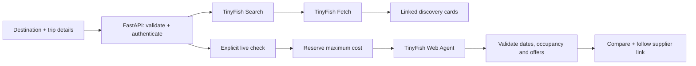

<p align="center">
  <a href="https://wanderers-znqi.vercel.app"></a>
</p>

<p align="center">
  <a href="https://wanderers-znqi.vercel.app"><strong>Explore Wanderer ↗</strong></a> &nbsp; · &nbsp;
  <a href="#tinyfish-the-research-behind-the-journey">TinyFish integration</a> &nbsp; · &nbsp;
  <a href="#try-the-hackathon-flow">Demo walkthrough</a> &nbsp; · &nbsp;
  <a href="docs/DEVELOPMENT.md">Run & deploy</a>
</p>

# A place to find your elsewhere.

**Built for Kritical Hacks 2026 · Travel research powered by TinyFish.**

Wanderer turns India's lesser-known places into journeys worth keeping. Explore an interactive atlas, research a trip with **TinyFish**, compare stays and experiences, and bring the journey home as a stamp in your personal passport.

**Thirty places to begin. Sources to travel with confidence. A journal to make it yours.**

## TinyFish: the research behind the journey

A destination card tells you where to go. **TinyFish helps you investigate the next question: what do I need to know before I get there?**

Wanderer brings TinyFish's **Search, Fetch and Web Agent APIs** into the existing trip planner. Research reuses the destination, dates, travel style, adults and room count, so visitors can move from inspiration to sourced information without rebuilding their trip.

| In the planner | TinyFish does the work | Visitors get |
| :--- | :--- | :--- |
| **Trip essentials** | **Search** finds official visitor, access, activity and food information. Bounded **Fetch** requests read the discovered pages. | Source cards, readable excerpts, direct links and checked times. |
| **Stays & experiences** | **Search + Fetch** discover shortlists. An explicit supplier check starts an asynchronous **Web Agent** run with structured output. | Up to five stays and five experiences; observed price, currency, pricing basis, taxes and cancellation terms when confirmed. |
| **Resume, retry, cancel** | FastAPI persists provider run IDs and polls active jobs. Matching requests reuse jobs and cached results. | Reload recovery and useful partial results; trip edits reject stale responses. |



**The detail that matters:** a search snippet never becomes a verified price. Hotel dates and occupancy must match; experiences need a valid activity date. Missing prices, taxes or availability stay **Not confirmed**. Wanderer preserves source currencies and never invents conversions.

### Free for the traveller. Bounded for the builder.

Guests and account holders pay nothing. There is no checkout, subscription, upgrade or funding prompt.

- A shared, durable database ledger enforces a **$9 lifetime app allowance**, independent of the account's wallet balance.
- Each paid run reserves its full maximum cost before starting. Ambiguous starts and missing usage keep the reservation; retries do not blindly create another paid run.
- One active paid run per identity, two globally; one paid check per identity and two per IP daily. Search/Fetch have conservative daily quotas.
- The key stays on the backend. Local storage uses AES-256-GCM and a separate ignored encryption key; deployed credentials belong in a hosting secret store.
- External results render as text. Links must match approved HTTPS sources. Browsing tasks receive no login credentials or payment details.

[Integration setup, source gates and limits](docs/TINYFISH.md) · [Test-first implementation evidence](docs/TINYFISH.tdd.md)

## Try the hackathon flow

For the **Kritical Hacks 2026** demo:

1. Run the frontend and FastAPI locally using the [development guide](docs/DEVELOPMENT.md). Open **Trips** (`/planner`) and choose a destination, dates and travel style.
2. Open **Research this trip → Trip essentials → Find sources**. Follow a source link or expand its fetched excerpt.
3. Switch to **Stays & experiences**. Set adults, rooms and check-out, then discover each shortlist.
4. On a pilot-approved source, **Check live options** starts an asynchronous date check. Compare confirmed offers, reload to resume, or cancel. Otherwise, supplier links remain available.
5. Save the trip and return to the passport to keep your travel story.


## One journey, four chapters

| Chapter | What is already here |
| :--- | :--- |
| **01 / Discover** | A 3D atlas, state journeys and 30 catalog destinations, with search and filters for state, category, travel status and estimated budget. |
| **02 / Plan** | Dates, travel style, transport, budget estimates, day plans, up to three ordered stops, OSRM road routes and saved trips. |
| **03 / Research** | TinyFish source discovery and guarded stays/experiences comparisons inside the planner. |
| **04 / Remember** | Private notes and ratings, visit logs, passport stamps, travel XP, achievements and journal export. Public stories require explicit profile consent. |

Light, dark and system themes. Keyboard-accessible controls. Reduced-motion support. Guest passports that can become accounts without losing the journey.

## Under the cover

| Layer | Stack |
| :--- | :--- |
| Interface | React · TypeScript · Vite · Framer Motion |
| Atlas & maps | Three.js / React Three Fiber · Leaflet · CARTO |
| API & storage | FastAPI · SQLAlchemy · Alembic · SQLite locally / PostgreSQL for deployment |
| Travel research | **TinyFish Search · Fetch · Web Agent** |
| Other services | Open-Meteo weather / GeoNames city lookup · OSRM routes · optional Redis and Hugging Face chat |

```text
frontend/       atlas, planner, TinyFish research panels, passport, community
backend/        auth, journals, trips, research jobs, budget ledger, migrations
scripts/        local lifecycle and encrypted key setup
pdf-generator/ PDF tooling and browser verification harnesses
docs/           setup, source verification and test evidence
```

## Make it your own

Use Node.js 24 and Python with the system libraries required by WeasyPrint.

```sh
git clone https://github.com/aaravkalia-88/wanderers.git
cd wanderers
python3 -m venv backend/venv
backend/venv/bin/pip install -r backend/requirements.txt
npm ci --prefix frontend
```

For a **new checkout only**, copy `backend/.env.example` to `backend/.env`, generate a random `SECRET_KEY` and replace the example value. Preserve existing environment files and journals.

```sh
backend/venv/bin/python -c 'import secrets; print(secrets.token_urlsafe(48))'
bash run_local.sh
```

Open **[127.0.0.1:5173](http://127.0.0.1:5173)**. FastAPI runs on port 8000; Vite proxies `/api`. Stop both with Ctrl+C. TinyFish is optional; use its [hidden key prompt](docs/TINYFISH.md#local-setup) to configure research.

## Ship & verify

The public frontend is **[wanderers-znqi.vercel.app](https://wanderers-znqi.vercel.app)**. Vercel builds from the repository root using [`vercel.json`](vercel.json). Host FastAPI with a durable database, set `VITE_API_BASE_URL` to its URL including `/api/v1`, configure exact CORS origins and redeploy. Never put TinyFish keys, database credentials or session secrets in `VITE_*` variables.

[Local setup & deployment guide](docs/DEVELOPMENT.md) · [Vercel verification](docs/VERCEL_DEPLOYMENT.tdd.md) · [Encrypted CARTO setup](docs/CARTO_ENV.tdd.md)

```sh
npm --prefix frontend test
npm --prefix frontend run build
cd backend
venv/bin/python -m unittest discover -s tests -v
```

Research tests mock the provider and use temporary databases. They cover ownership, validation, duplicate requests, concurrent budget reservations, cancellation, lost starts, settlement and migration preservation without charges. The fixture-only browser harness checks both tabs, reload recovery, stale responses, keyboard controls and mobile/dark layouts. See [the evidence report](docs/TINYFISH.tdd.md) for exact checks and limits.

## Honest field notes

Catalog costs, durations and activities are planning estimates; photography may be illustrative. Confirm access, prices and availability with the linked source before travelling. Keyword search and saved-category recommendations are deterministic. There is no automatic booking or currency conversion.

Private travel records stay private. Community publishing requires an account and explicit consent. Comments, likes, follows, uploads, account recovery and token refresh remain future work. Guest credentials stay in the browser; create an account to return on another device. Sessions currently expire after seven days.

PostgreSQL deployment and concurrency need deployment verification; the research concurrency suite uses SQLite. The broad migration check has known pre-existing user/catalog index drift. Local encrypted CARTO storage protects the file; the tile key is still visible in browser requests. Detailed limits live in the linked integration notes.

---

<p align="center"><em>Small footprints. Lasting stories.</em><br />Built by <a href="https://github.com/aaravkalia-88">Aarav Kalia</a> · Made for the curious.</p>
